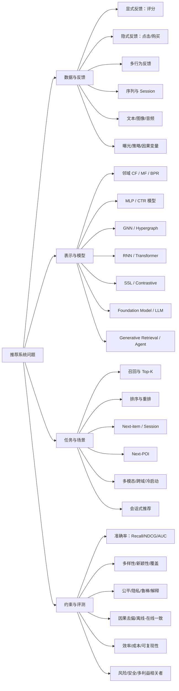
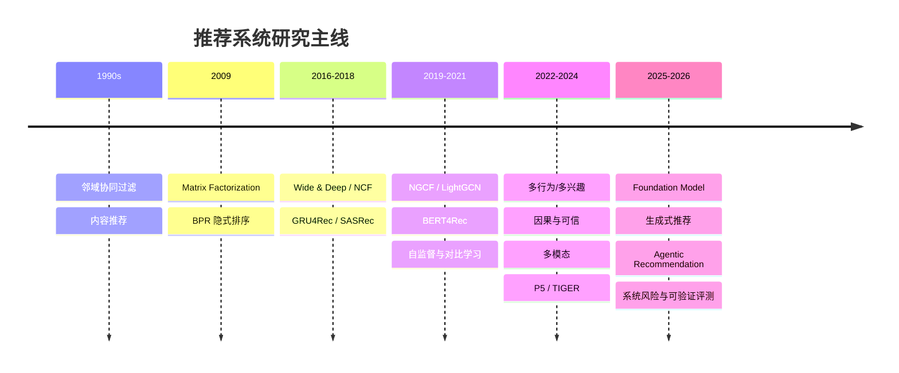
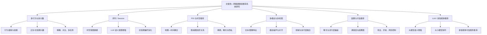
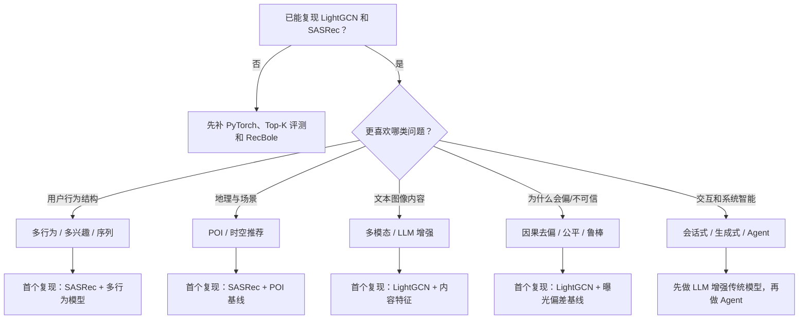
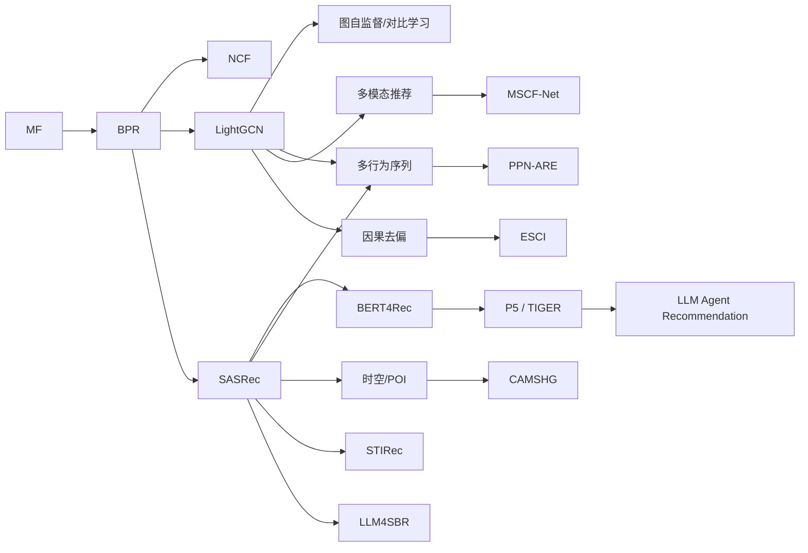

# 推荐系统学术地图（2026）

## 1. 全领域地图

## 2. 技术演进主线

## 3. 课题组方向定位

## 4. 新手选方向决策树

## 5. 论文阅读依赖图

## 6. 地图的核心判断

- 最底层共同基础是隐式反馈、Embedding、排序损失和 Top-K 评测。
- 课题组当前最密集的区域是多行为/多兴趣、序列/POI、多视图融合和可信推荐。
- LLM 并不是一条独立替代路线，它与语义增强、生成式检索、会话交互和系统模拟四类任务交叉。
- 因果、可信和可复现评测应作为每个分支的横向约束，而不是最后附加的一节。

